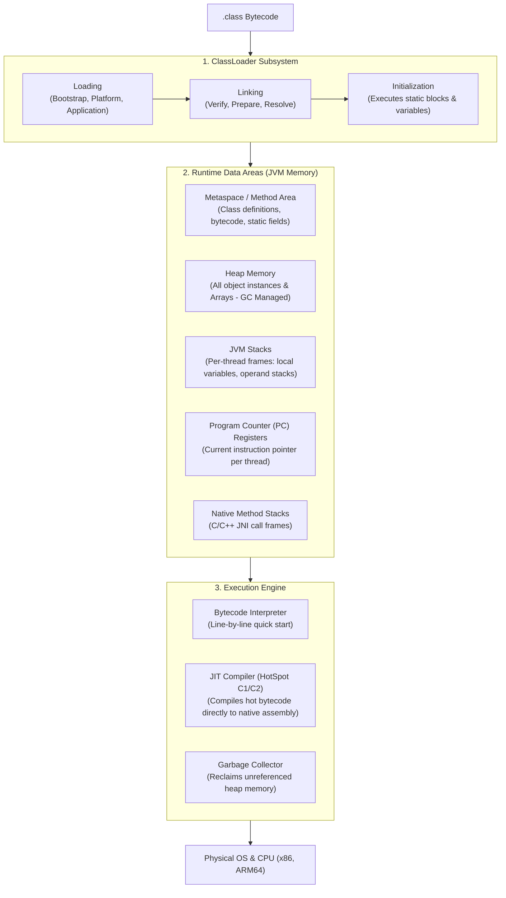
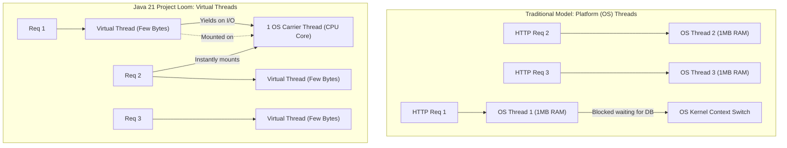
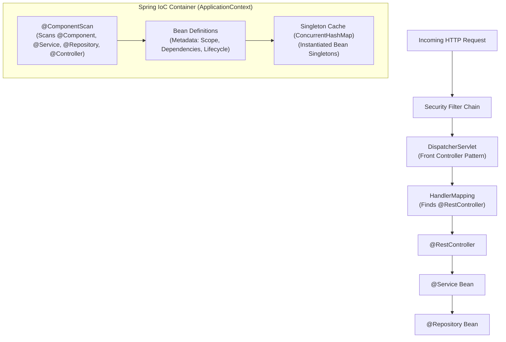
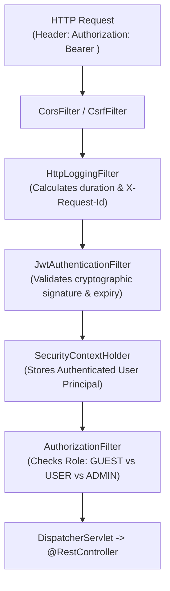
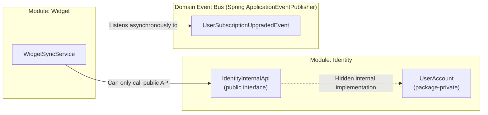

# Java, Spring Boot & Enterprise Architecture: The Complete Interview & Mastery Handbook

> **"Master the internals, own the architecture, ace the interview."**  
> A comprehensive, senior-to-staff level technical guide covering Java runtime internals, JVM execution mechanics, concurrency & Project Loom, Spring Boot 3.3.x/4.x architecture, Spring Modulith, JPA/Hibernate deep dives, and high-frequency interview question breakdowns.

---

# Table of Contents
1. [Section 1: The Core Philosophy & Short History of Java](#section-1-the-core-philosophy--short-history-of-java)
2. [Section 2: The JVM Architecture Deep Dive (Under the Hood)](#section-2-the-jvm-architecture-deep-dive-under-the-hood)
3. [Section 3: Garbage Collection & Memory Management](#section-3-garbage-collection--memory-management)
4. [Section 4: Concurrency, Threading & Project Loom (Virtual Threads)](#section-4-concurrency-threading--project-loom-virtual-threads)
5. [Section 5: Modern Java Evolution (Java 8 to 21 LTS)](#section-5-modern-java-evolution-java-8-to-21-lts)
6. [Section 6: Spring & Spring Boot Architecture Deep Dive](#section-6-spring--spring-boot-architecture-deep-dive)
7. [Section 7: Spring Data JPA, Hibernate & Database Internals](#section-7-spring-data-jpa-hibernate--database-internals)
8. [Section 8: Spring Security & Stateless JWT Architecture](#section-8-spring-security--stateless-jwt-architecture)
9. [Section 9: Modular Monolith vs. Microservices (Spring Modulith)](#section-9-modular-monolith-vs-microservices-spring-modulith)
10. [Section 10: Rosetta Stone (Java vs. Node.js vs. Python vs. Go)](#section-10-rosetta-stone-java-vs-nodejs-vs-python-vs-go)
11. [Section 11: Top 30 High-Frequency Technical Interview Questions & Answers](#section-11-top-30-high-frequency-technical-interview-questions--answers)

---

# 1. Core Philosophy & Language Origins

### 1.1 The Genesis (1991–1995)
In the early 1990s, **James Gosling, Mike Sheridan, and Patrick Naughton** at Sun Microsystems started the "Green Project." Their goal was writing software for networked consumer devices (set-top TV boxes, smart remotes, embedded home electronics).

The software industry back then ran almost entirely on **C and C++**, which had two fatal engineering liabilities:
1. **Hardware & OS Lock-in**: C/C++ compiles into CPU-specific assembly instructions (x86, ARM, SPARC). A program compiled for an Intel Windows machine could not execute on Motorola Mac or Sun Solaris hardware without being rewritten or recompiled with platform-specific libraries.
2. **Manual Memory Management & Pointer Disasters**: Developers manually managed memory using raw pointers (`malloc`, `free`). Minor programming bugs resulted in **segmentation faults, buffer overflows, dangling pointers, and memory leaks**, which crashed entire host operating systems.

### 1.2 The "WORA" Paradigm
Gosling engineered Java around a foundational architectural premise:  
> **"Write Once, Run Anywhere (WORA)."**

Instead of compiling source code into physical machine instructions, Java compiles into a universal intermediate representation called **Bytecode (`.class`)**. The physical operating system runs a virtual machine—the **Java Virtual Machine (JVM)**—which translates bytecode into the host machine’s specific CPU instructions at runtime.

### 1.3 Key Milestones in Java History
* **1995 (Java 1.0)**: Initial public release by Sun Microsystems. Introduces Applets, garbage collection, and cross-platform bytecode.
* **2004 (Java 5)**: Massive language evolution: Generics, Annotations, Enums, Varargs, and the `java.util.concurrent` package (designed by Doug Lea).
* **2010**: Oracle Corporation acquires Sun Microsystems and assumes stewardship of Java and the open-source **OpenJDK** project.
* **2014 (Java 8 LTS)**: The biggest leap in Java syntax: Lambdas, Functional Interfaces, Streams API, and `java.time` (JSR-310).
* **2017 (Java 9)**: Modular Java (**Project Jigsaw**), introducing `module-info.java` to break up the monolithic runtime library.
* **2021 (Java 17 LTS)**: Modern language features solidified: Sealed Classes, Pattern Matching instanceof, Records, Text Blocks.
* **2023 (Java 21 LTS)**: Revolutionary concurrency release: **Project Loom (Virtual Threads)**, Sequenced Collections, Record Patterns.

---

# 2. JVM Architecture Deep Dive (Under the Hood)

The Java Virtual Machine (JVM) is an abstract computing machine that has its own instruction set and manipulates various memory areas at runtime.



### 2.1 The ClassLoader Subsystem
Class loading occurs in three sequential phases:
1. **Loading**: Reads the binary `.class` file bytes from disk or network and creates a `java.lang.Class` instance.
   * **Bootstrap ClassLoader**: Written in native C/C++; loads core JDK classes from `java.base` (e.g., `java.lang.Object`, `java.lang.String`).
   * **Platform / Extension ClassLoader**: Loads platform-specific extensions.
   * **Application / System ClassLoader**: Loads classes located on your application classpath (your code and Maven/Gradle dependencies).
   * **Delegation Hierarchy (Parent Delegation Model)**: When a ClassLoader needs to load a class, it delegates the request to its parent first. Only if the parent fails does the child attempt to load it. This prevents malicious code from replacing core classes like `java.lang.SecurityManager`.
2. **Linking**:
   * **Verification**: Rigorously analyzes bytecode to ensure it does not violate JVM constraints (e.g., no stack overflows, no illegal type casts, valid pointer references).
   * **Preparation**: Allocates memory for `static` fields and initializes them to their default primitive values (`0`, `null`, `false`).
   * **Resolution**: Replaces symbolic references in the constant pool with direct memory addresses.
3. **Initialization**: Executes static initializers and assigns explicit initial values to `static` variables (`static int count = 42;`).

### 2.2 Runtime Memory Areas

| Memory Area | Shared or Thread-Local? | What It Stores | Lifetime |
| :--- | :--- | :--- | :--- |
| **JVM Stack** | **Thread-Local** | Stack frames containing primitive local variables, operand stacks, and references to Heap objects. | Destroyed when the thread terminates. |
| **PC Register** | **Thread-Local** | Pointer to the current bytecode instruction being executed by the thread. | Destroyed when the thread terminates. |
| **Heap** | **Shared Across All Threads** | All instantiated objects (`new UserAccount()`), Arrays, and String pool contents. | Managed by the Garbage Collector. |
| **Metaspace** | **Shared Across All Threads** | Class structure, method bytecode, annotations, method tables, and static fields. | Off-heap native memory; expands dynamically. |
| **Native Method Stack** | **Thread-Local** | State of native C/C++ methods called via JNI (Java Native Interface). | Destroyed when thread terminates. |

> [!IMPORTANT]
> **Metaspace vs. PermGen**: Before Java 8, class metadata was stored in **PermGen** (Permanent Generation) inside the JVM Heap, which frequently triggered `java.lang.OutOfMemoryError: PermGen space`. Java 8 replaced PermGen with **Metaspace**, which allocates memory directly from native OS RAM, eliminating arbitrary size caps unless bounded by `-XX:MaxMetaspaceSize`.

### 2.3 The Execution Engine: Interpreter vs. JIT Compiler
The JVM uses a **Tiered Hybrid Execution Engine**:
1. **Interpreter**: Starts up immediately by reading bytecode instructions and executing them line-by-line. It requires zero compilation time, ensuring rapid application boot.
2. **JIT (Just-In-Time) Compiler (HotSpot)**: While the interpreter executes code, background profilers monitor method invocation counters and loop back-edge counters.
   * **C1 Compiler (Client Compiler)**: Quickly compiles frequently called methods into optimized native code with minimal profiling overhead.
   * **C2 Compiler (Server Compiler)**: When code becomes extremely "hot", C2 heavily optimizes it:
     * **Method Inlining**: Replaces method calls with the actual method body, eliminating call-stack overhead.
     * **Loop Unrolling & Vectorization**: Converts loops into parallel SIMD CPU instructions.
     * **Escape Analysis**: Determines if an object never escapes the method scope. If it doesn't escape, the JVM optimizes away the Heap allocation and allocates the object directly on the **Stack (Scalar Replacement)**, completely bypassing garbage collection!

---

# 3. Garbage Collection & Memory Management

In C/C++, developers manually allocate and free memory. In Java, the **Garbage Collector (GC)** runs continuously in the background to automatically identify and deallocate unreferenced objects.

### 3.1 The Weak Generational Hypothesis
Java garbage collection is based on an empirical observation:
1. **Most created objects have very short lifespans** (e.g., local variables inside a method, temporary DTOs, HTTP request wrappers).
2. **Objects that survive initial collections tend to live for a very long time** (e.g., Spring Singleton beans, connection pools, long-term caches).

```mermaid
flowchart LR
    subgraph HeapMemory["JVM Heap Memory Breakdown"]
        subgraph YoungGen["Young Generation (High Churn / Minor GC)"]
            Eden["Eden Space\n(New objects allocated here)"]
            S0["Survivor S0\n(FromSpace)"]
            S1["Survivor S1\n(ToSpace)"]
        end
        subgraph OldGen["Old Generation (Tenured)"]
            Tenured["Tenured Space\n(Survives N collections -> Major GC)"]
        end
    end
    Eden -->|Survives Minor GC| S0
    S0 <-->|Alternates per GC| S1
    S1 -->|Threshold Met (e.g. age=15)| Tenured
```

### 3.2 GC Algorithms Compared

| Garbage Collector | Flag | Best Use Case | How It Works |
| :--- | :--- | :--- | :--- |
| **Serial GC** | `-XX:+UseSerialGC` | Single-threaded, CLI tools, small memory (<100MB). | Single-threaded Stop-The-World (STW) collector. |
| **Parallel GC** | `-XX:+UseParallelGC` | High throughput batch processing, data analytics. | Multi-threaded Minor & Major collections; prioritizes throughput over low latency. |
| **G1 GC (Garbage-First)** | `-XX:+UseG1GC` | **Default since Java 9**. General enterprise APIs. | Divides Heap into equal-sized regions (~1MB to 32MB). Collects regions containing the most garbage first within a target pause time (`-XX:MaxGCPauseMillis=200`). |
| **ZGC (Z Garbage Collector)** | `-XX:+UseZGC` | Ultra-low latency enterprise APIs (Heap size: 16MB to 16TB). | **Pause times < 1 millisecond**, regardless of Heap size! Performs reference coloring and load barriers concurrently with application threads. |
| **Shenandoah GC** | `-XX:+UseShenandoahGC` | Ultra-low latency, concurrent compaction. | Performs concurrent evacuation of objects in memory alongside running application threads. |

### 3.3 What Causes Memory Leaks in Java?
Even with garbage collection, a Java application can still suffer from **Memory Leaks** (leading to `java.lang.OutOfMemoryError: Java heap space`). A memory leak in Java occurs when **unintentional strong references remain to objects that the application no longer needs**:
1. **Static Collections**: Adding objects to `public static final List<Data>` without clearing them. Static fields are rooted in the ClassLoader and are never garbage collected during the application lifecycle.
2. **Unclosed System Resources**: Forgetting to close database `Connection`, `ResultSet`, `InputStream`, or socket handles. (Always use `try-with-resources`).
3. **ThreadLocal Leaks in Thread Pools**: Application servers reuse threads. If you call `threadLocal.set(val)` and never call `threadLocal.remove()`, the object remains pinned in memory forever.
4. **Improper `equals()` and `hashCode()`**: Using custom objects as keys in a `HashMap` or `HashSet` without implementing both methods. The map cannot find existing keys and continuously accumulates duplicate objects.

---

# 4. Concurrency, Threading & Project Loom (Virtual Threads)

Concurrency is the execution of multiple execution sequences at the same time.

### 4.1 Traditional Platform Threads vs. Virtual Threads (Project Loom)



| Characteristic | Traditional Platform Thread | Java 21 Virtual Thread (Project Loom) |
| :--- | :--- | :--- |
| **Mapping** | $1:1$ with Host OS Thread | $M:N$ (Millions of Virtual Threads mapped to a few OS Carrier Threads) |
| **Memory Footprint** | $\approx 1\text{ MB}$ Stack pre-allocated | $\approx \text{Few Hundred Bytes}$ (Heap allocated, dynamically resized) |
| **Context Switch Cost** | Expensive CPU kernel context switch | Inexpensive JVM user-space continuation switch |
| **Max Concurrency** | $\approx 2,000 - 5,000$ before server runs out of RAM | **Millions of concurrent threads** without memory exhaustion |
| **Blocking Behavior** | Thread blocks the underlying OS thread | Thread **unmounts** from carrier thread on I/O (Postgres query, Redis call, LLM HTTP call) |
| **Spring Boot Configuration** | Default thread pool | `spring.threads.virtual.enabled: true` |

### 4.2 Core Concurrency Primitives

#### 1. The `synchronized` Keyword & Monitor Locks
Every Java object has an internal **Intrinsic Lock (Monitor)**.
* When a thread enters a `synchronized(this)` block, it acquires the monitor. Other threads trying to enter are forced into a `BLOCKED` state.
* **Under the Hood (HotSpot)**: Java optimizes monitor locks through three stages:
  1. **Biased Locking**: If only one thread ever accesses the lock, it avoids atomic CPU operations entirely.
  2. **Lightweight Locking**: If threads access the lock without contention, it uses atomic CAS (Compare-And-Swap) operations on the object header.
  3. **Heavyweight Locking**: When true contention occurs, the thread is inflated into an OS mutex, parking the thread in the OS scheduler.

#### 2. The `volatile` Keyword
* **Problem**: Modern CPUs have L1, L2, and L3 caches. Threads copy variables into CPU core caches. Changes made by Thread A on Core 1 are not immediately visible to Thread B on Core 2.
* **Solution**: `volatile` guarantees **Visibility** and **Ordering (Prevents Instruction Reordering via CPU Memory Barriers)**.
* *Note*: `volatile` does **NOT** guarantee atomicity! (`count++` is three operations: read, increment, write. `volatile` does not make `count++` thread-safe; use `AtomicInteger` instead).

#### 3. `ReentrantLock` vs. `synchronized`
`ReentrantLock` (from `java.util.concurrent.locks`) provides capabilities that `synchronized` cannot:
* Ability to interrupt a thread waiting for a lock (`lockInterruptibly()`).
* Ability to attempt locking with a timeout (`tryLock(100, TimeUnit.MILLISECONDS)`).
* Fairness policy (`new ReentrantLock(true)`) preventing thread starvation.

---

# 5. Modern Java Evolution (Java 8 to 21 LTS)

### 5.1 Java 8 LTS: Functional Programming & Streams
* **Lambdas & Functional Interfaces**: Any interface with exactly one abstract method is a `@FunctionalInterface` (e.g., `Predicate<T>`, `Function<T, R>`, `Consumer<T>`, `Supplier<T>`).
* **Streams API**: Functional processing pipelines over collections (intermediate operations like `map()`, `filter()`, `flatMap()` are lazy; terminal operations like `collect()`, `reduce()` trigger computation).
* **`Optional<T>`**: Explicit container object to avoid returning `null` and eliminate unexpected `NullPointerExceptions`.

### 5.2 Java 11 LTS: Modern Developer Ergonomics
* **Local Variable Type Inference (`var`)**: Allows the compiler to infer static types while preserving strict type safety:
  ```java
  var user = new UserAccount("seeker@manasvia.com"); // Still strictly typed
  ```
* **Native HTTP Client (`java.net.http.HttpClient`)**: Modern, non-blocking HTTP/2 and WebSocket client replacing legacy `HttpURLConnection`.

### 5.3 Java 17 LTS: Structural Integrity
* **Records**: Immutable data carriers with auto-generated constructor, getters, `equals()`, `hashCode()`, and `toString()`:
  ```java
  public record UserSummaryDto(UUID id, String email, String role) {}
  ```
* **Sealed Classes (`sealed ... permits`)**: Restricts which specific classes can extend or implement an interface:
  ```java
  public sealed interface AuthProvider permits GoogleAuth, AppleAuth, GuestAuth {}
  ```
* **Pattern Matching for `instanceof`**: Eliminates manual casting:
  ```java
  if (obj instanceof String s) {
      System.out.println(s.toUpperCase()); // No (String) obj casting needed
  }
  ```

### 5.4 Java 21 LTS: The Concurrency Revolution
* **Virtual Threads (`Thread.ofVirtual()`)**: Scalable, high-throughput lightweight threads.
* **Pattern Matching for Switch**:
  ```java
  return switch (userRole) {
      case GUEST -> "Welcome, Explorer";
      case PREMIUM p when p.isExpired() -> "Please renew your subscription";
      case PREMIUM p -> "Welcome back, Seeker";
      case ADMIN -> "Accessing Admin Console";
  };
  ```
* **Sequenced Collections**: Introduces unified methods for first and last elements across lists and sets (`getFirst()`, `getLast()`, `reversed()`).

---

# 6. Spring & Spring Boot Architecture Deep Dive

Spring is an enterprise application framework. Spring Boot is an opinionated layer on top of Spring that eliminates boilerplate XML configuration via **Auto-Configuration** and embedded servers.



### 6.1 Inversion of Control (IoC) & Dependency Injection (DI)
* **Inversion of Control**: In traditional software, your code controls program flow and directly instantiates dependencies (`AuthService service = new AuthService()`). In IoC, the **framework controls the lifecycle** and instantiates components for you.
* **Dependency Injection**: The mechanism where the IoC container passes required dependencies into a class at runtime.
* **Constructor Injection (Enterprise Best Practice)**:
  ```java
  @Service
  public class AuthService {
      private final UserRepository userRepository; // immutable final dependency

      public AuthService(UserRepository userRepository) {
          this.userRepository = userRepository;
      }
  }
  ```
  *Why Constructor Injection over `@Autowired` field injection?*
  1. Enforces immutability (`final` fields).
  2. Prevents `NullPointerException` during testing (dependencies cannot be omitted).
  3. Detects circular dependencies at compilation/instantiation time.

### 6.2 Spring Bean Scopes

| Scope | Definition | Thread Safety |
| :--- | :--- | :--- |
| **`singleton`** *(Default)* | Exactly one instance created per Spring IoC container. Cached in `ApplicationContext`. | **Must be stateless** (no mutable instance variables). |
| **`prototype`** | A new instance is created every time the bean is requested. | Thread-safe per caller. |
| **`request`** | One instance per HTTP request lifecycle (web applications). | Thread-safe per HTTP request. |
| **`session`** | One instance per HTTP session lifecycle. | Thread-safe per user session. |

### 6.3 The Spring Bean Lifecycle
When the Spring ApplicationContext starts, each bean undergoes this lifecycle:
1. **Instantiation**: Constructor invoked via Java Reflection.
2. **Populate Properties**: Dependencies injected via setters or constructors.
3. **Aware Interfaces**: Spring calls `BeanNameAware`, `ApplicationContextAware`.
4. **BeanPostProcessor (Pre-Initialization)**: `postProcessBeforeInitialization()` runs (e.g., AOP proxies created).
5. **Initialization**: Methods annotated with `@PostConstruct` execute, followed by `InitializingBean.afterPropertiesSet()`.
6. **BeanPostProcessor (Post-Initialization)**: `postProcessAfterInitialization()` runs (CGLIB/Dynamic proxies finalized).
7. **Ready for Use**: Bean serves requests.
8. **Destruction**: Methods annotated with `@PreDestroy` execute when the container shuts down gracefully.

---

# 7. Spring Data JPA, Hibernate & Database Internals

### 7.1 The Stack: JDBC vs. Hibernate vs. Spring Data JPA
* **JDBC (Java Database Connectivity)**: Low-level API for executing raw SQL queries and managing database connections.
* **Hibernate**: An **ORM (Object-Relational Mapping)** framework implementing the JPA specification. Maps Java classes (`@Entity`) to relational database tables, managing SQL generation, caching, and transactions.
* **Spring Data JPA**: A repository abstraction layer on top of Hibernate. Eliminates boilerplate CRUD code by generating dynamic queries from repository method names (`findByGoogleId(String id)`).

### 7.2 The Persistence Context & First-Level Cache
Inside a `@Transactional` boundary, Hibernate manages entities within a **Persistence Context**:
* **First-Level Cache**: If you query for `UserAccount` with ID `1` twice in the same transaction, Hibernate executes SQL only on the first call. The second call returns the cached in-memory instance.
* **Dirty Checking**: At the end of the transaction, Hibernate automatically compares the current state of entities against a snapshot taken when they were loaded. If fields changed, Hibernate automatically executes `UPDATE` SQL without you calling `repository.save()`.

### 7.3 The Infamous N+1 Query Problem & Fixes
The **N+1 Problem** is the most common database performance bug in ORM applications.
* **How it happens**: You query for 100 `SoulProfile` records. Each profile has a lazily loaded `DistressSignature`. If you loop through the 100 profiles and call `profile.getDistressSignature()`, Hibernate executes **1 initial query** for the profiles, followed by **100 individual queries** for each signature ($1 + N = 101$ SQL queries!).

#### 3 Ways to Fix the N+1 Problem:
1. **JOIN FETCH (JPQL)**:
   ```java
   @Query("SELECT p FROM SoulProfile p JOIN FETCH p.distressSignature")
   List<SoulProfile> findAllWithSignatures();
   ```
2. **`@EntityGraph`**:
   ```java
   @EntityGraph(attributePaths = {"distressSignature"})
   List<SoulProfile> findAll();
   ```
3. **Batch Fetching (`hibernate.default_batch_fetch_size: 50`)**: Instructs Hibernate to load lazy associations using SQL `WHERE id IN (?, ?, ...)` in batches rather than individual queries.

---

# 8. Spring Security & Stateless JWT Architecture

### 8.1 The Security Filter Chain
In Spring Security, security is enforced by a pipeline of servlet filters executed before requests reach your controllers:



### 8.2 Why Mobile APIs Must Be Stateless
* Traditional web applications use **Stateful Session Cookies (`JSESSIONID`)**: The server allocates RAM in its session table for every logged-in user. If you run 5 backend servers behind a load balancer, you must configure sticky sessions or distributed session replication.
* **Stateless REST APIs (JWT)**: The server stores zero session state in RAM. The JWT token is a cryptographically signed payload (`Header.Payload.Signature`) containing user claims and expiration timestamps:
  * Any server node can verify the signature using the shared secret key.
  * Frictionless horizontal scaling across 100+ cloud container nodes.

---

# 9. Modular Monolith vs. Microservices (Spring Modulith)

### 9.1 The Monolith vs. Microservices Trap
Many startups adopt microservices too early, incurring severe operational overhead:
* Network serialization latency between internal services.
* Complex distributed transactions (Saga Pattern, 2-Phase Commit).
* Complex infrastructure: Service meshes, API Gateways, distributed tracing, Kubernetes clusters.

### 9.2 The Spring Modulith Architecture (Manasvia’s Paradigm)
Manasvia uses an **Event-Driven Modular Monolith**:
1. **Single Deployment Artifact**: Runs as one efficient `.jar` file on Java 21 Virtual Threads.
2. **In-Memory Method Calls**: Inter-module queries execute at in-memory speed without network serialization.
3. **Strict Bounded Contexts**: The codebase is split into 6 isolated modules: `identity`, `profile`, `wisdom`, `widget`, `reflection`, `billing`.



#### The 3 Architectural Laws of Spring Modulith:
* **Law 1: Schema Isolation**: Tables are prefixed (`identity_*`, `wisdom_*`). No SQL `JOIN` queries across different module domains.
* **Law 2: Interface Segregation**: JPA entities are `package-private`. Other modules can only consume public DTOs via the module's `api/` package.
* **Law 3: Domain Event Decoupling**: Modules broadcast state changes asynchronously via `ApplicationEventPublisher`. When a module needs to be extracted into an independent microservice later, swapping in-memory events for Kafka or Redis Streams requires zero changes to business logic!

---

# 10. Technology Comparison (Java vs. Node.js vs. Python vs. Go)

| Architectural Dimension | **Java 21 LTS (Spring Boot)** | **Node.js (NestJS / Express)** | **Python (FastAPI / Django)** | **Go (Golang)** |
| :--- | :--- | :--- | :--- | :--- |
| **Execution Model** | JIT-compiled Bytecode to native machine assembly | V8 JIT compilation to native assembly | Interpreted Bytecode (CPython) | Statically compiled native AOT binary |
| **Concurrency Architecture** | **Virtual Threads (Project Loom)** + OS Multi-threading | **Single-threaded Event Loop** (Worker threads for CPU work) | **Single-threaded GIL** (Asyncio cooperative multitasking) | **Goroutines** (M:N cooperative user-space scheduler) |
| **Type Safety** | Static, strong, strictly enforced at compile time | Dynamic (TypeScript adds compile-time check, erased at runtime) | Dynamic (Type hints checked by linters, erased at runtime) | Static, structural typing, compile-time enforced |
| **I/O Bottleneck Handling** | Virtual threads unmount automatically on blocking I/O | Non-blocking async/await callback queue | Async/await event loop | Channels & Goroutines yield on blocking syscalls |
| **Compute / CPU-Bound Tasks** | **Exceptional** (Parallel streams, multi-core SIMD JIT) | **Poor** (Blocks the entire event loop for all users) | **Poor** (GIL serializes CPU work onto a single core) | **Exceptional** (Multi-core native execution) |
| **Memory Consumption** | Moderate to High (JVM runtime overhead) | Moderate (V8 isolate overhead) | Low to Moderate | **Ultra-Low** (Tiny runtime, no heavy virtual machine) |
| **Best Production Use Case** | High-scale enterprise backends, fintech, high-concurrency APIs | Real-time I/O, chat apps, full-stack JavaScript teams | AI/ML pipelines, data science, rapid prototyping | Microservices, networking tools (Docker, Kubernetes), low-memory CLI |

---

# 11. Top 30 High-Frequency Technical Interview Questions & Answers

### Q1: Why is `String` immutable in Java?
**Answer**:
1. **String Constant Pool**: If strings were mutable, changing a string in one variable would alter the value for all other variables referencing the same pooled literal.
2. **Security**: Strings are used for sensitive system parameters (database URLs, user credentials, network sockets). If mutable, an attacker could alter credentials after security checks pass.
3. **Thread Safety**: Immutable objects are inherently thread-safe without synchronization.
4. **Caching HashCodes**: The `hashCode()` of a String is computed once and cached. This makes Strings optimal keys in `HashMap` and `HashSet`.

---

### Q2: What is the contract between `equals()` and `hashCode()`?
**Answer**:
1. If two objects are equal according to `equals(Object)`, they **must** return the same integer from `hashCode()`.
2. If two objects have the same `hashCode()`, they are **not necessarily equal** (this is a Hash Collision).
3. If you override `equals()`, you **must** override `hashCode()`. Failing to do so breaks hash-based collections (`HashMap`, `HashSet`), causing `map.get(key)` to return `null` even for identical keys.

---

### Q3: What is the difference between `==` and `.equals()`?
**Answer**:
* `==` checks **Reference Equality** (memory addresses): Does Variable A point to the exact same memory address as Variable B? (Also compares raw values for primitives).
* `.equals()` checks **Value / Logical Equality**: Do the contents of the two objects match according to their class definition?

---

### Q4: Explain the difference between `Comparable` and `Comparator`.
**Answer**:
* **`Comparable<T>`**: Defines the **natural ordering** of an object. The class itself implements `compareTo(T o)` (e.g., `String`, `Integer`).
* **`Comparator<T>`**: Defines **custom external ordering** strategies. Implemented as standalone functions or lambdas (`Comparator.comparing(User::getCreatedAt).reversed()`).

---

### Q5: How does a `HashMap` work internally in Java?
**Answer**:
* A `HashMap` uses an array of buckets (`Node<K, V>[] table`).
* When you call `map.put(key, value)`:
  1. Computes the key's hash: `hash = (key == null) ? 0 : (h = key.hashCode()) ^ (h >>> 16)`.
  2. Calculates the bucket index: `index = (n - 1) & hash`.
  3. If the bucket is empty, it inserts a new `Node`.
  4. If a collision occurs, it traverses the linked list at that bucket:
     * If the key matches (`==` or `.equals()`), it replaces the value.
     * Otherwise, it appends to the list.
* **Java 8 Optimization**: If the number of nodes in a bucket exceeds **`TREEIFY_THRESHOLD = 8`** and table capacity $\ge 64$, the linked list converts into a **Red-Black Self-Balancing Binary Search Tree**, reducing lookup time from $O(N)$ down to $O(\log N)$ during hash collisions!

---

### Q6: What is the difference between `Fail-Fast` and `Fail-Safe` iterators?
**Answer**:
* **Fail-Fast** (e.g., `ArrayList`, `HashMap` iterators): Throws `ConcurrentModificationException` immediately if the underlying collection is modified during iteration (tracked via internal `modCount`).
* **Fail-Safe / Weakly Consistent** (e.g., `CopyOnWriteArrayList`, `ConcurrentHashMap` iterators): Iterates over a snapshot or clone of the collection; does not throw `ConcurrentModificationException` if modified concurrently.

---

### Q7: What is the difference between `@Component`, `@Service`, and `@Repository`?
**Answer**:
Functionally, all three are stereotyping annotations annotated with `@Component`, registering the class as a Spring Bean.
* **`@Component`**: Generic Spring-managed component.
* **`@Service`**: Semantic marker for business logic layers.
* **`@Repository`**: Marker for data persistence layers. **Critical Difference**: Spring automatically attaches a `PersistenceExceptionTranslationPostProcessor` to `@Repository` classes, automatically translating vendor-specific database exceptions (e.g., Hibernate or Postgres exceptions) into Spring's uniform `DataAccessException` hierarchy.

---

### Q8: What is the difference between `BeanFactory` and `ApplicationContext`?
**Answer**:
* **`BeanFactory`**: Basic IoC container. Uses **Lazy Loading** (instantiates beans only when `getBean()` is explicitly requested). Suitable for memory-constrained environments.
* **`ApplicationContext`**: Enterprise superset of `BeanFactory`. Uses **Eager Loading** (instantiates all Singleton beans on startup, catching configuration errors immediately). Adds support for AOP, internationalization (i18n), event publication, and web application contexts.

---

### Q9: How does Spring Boot Auto-Configuration work?
**Answer**:
When you annotate a class with `@SpringBootApplication`, it includes `@EnableAutoConfiguration`.
1. Spring Boot inspects classes present on your application **Classpath**.
2. It reads `META-INF/spring/org.springframework.boot.autoconfigure.AutoConfiguration.imports`.
3. It evaluates conditional annotations:
   * `@ConditionalOnClass(DataSource.class)` (Only configure database if driver is on classpath).
   * `@ConditionalOnMissingBean(DataSource.class)` (Only create default DataSource if the developer hasn't defined their own custom `@Bean`).
   * `@ConditionalOnProperty(name = "spring.threads.virtual.enabled", havingValue = "true")`.

---

### Q10: Why does `@Transactional` fail when calling a method from within the same class?
**Answer**:
**The Self-Invocation Proxy Trap**:
* Spring manages transactions using **AOP (Aspect-Oriented Programming) Proxies** (CGLIB or JDK Dynamic Proxies).
* When an external caller calls `authService.register()`, it calls the **Proxy Wrapper**, which begins the database transaction, invokes the target method, and commits/rollbacks the transaction.
* If `MethodA()` calls `this.MethodB()` internally within the same class, the call bypasses the Spring Proxy and invokes the target method directly. The transaction aspect never intercepts the call!
* **Fix**: Move `MethodB()` to a separate service class, or inject the service into itself via self-injection.

---

### Q11: What is the difference between `Propagation.REQUIRED` and `Propagation.REQUIRES_NEW`?
**Answer**:
* **`REQUIRED`** *(Default)*: Executes inside the current active transaction. If no transaction exists, creates a new one.
* **`REQUIRES_NEW`**: Suspends the current transaction (if one exists) and executes within a completely **new, independent transaction**. If the inner transaction fails or commits, it does not affect the outer transaction. (Useful for audit logging where logs must be saved even if the primary business transaction rolls back).

---

### Q12: What is the difference between `Session` and `EntityManager`?
**Answer**:
* **`EntityManager`**: The official standard interface defined by the **JPA (Java Persistence API)** specification. Portable across ORM vendors (Hibernate, EclipseLink).
* **`Session`**: The vendor-specific implementation interface provided by **Hibernate**. An `EntityManager` instance wraps an underlying Hibernate `Session`.

---

### Q13: What does `spring.jpa.open-in-view: false` do, and why should it always be `false` in production?
**Answer**:
* **OSIV (Open Session in View)** keeps the Hibernate database session and transaction open while the view or controller serializes JSON.
* **Why it must be `false`**: If OSIV is `true`, database connections are held open during the entire HTTP response serialization. If slow network clients take 500ms to receive JSON, database connections remain trapped, exhausting the connection pool (`HikariCP`). Setting it to `false` ensures connections are returned to the pool immediately when the `@Service` layer completes.

---

### Q14: What is the difference between Pessimistic Locking and Optimistic Locking?
**Answer**:
* **Optimistic Locking**: Assumes database collisions are rare. Uses a `@Version` integer column. When updating, executes `UPDATE ... WHERE id = ? AND version = 1`. If another transaction changed the version, Hibernate throws an `OptimisticLockException`. Zero database lock overhead.
* **Pessimistic Locking**: Assumes collisions will occur. Uses database-level locks: `SELECT ... FOR UPDATE` (`LockModeType.PESSIMISTIC_WRITE`). Other transactions trying to read or update the row are blocked at the database engine until the transaction completes.

---

### Q15: How do Virtual Threads interact with `synchronized` blocks (Thread Pinning)?
**Answer**:
* When a Virtual Thread encounters blocking I/O inside a plain method, it **unmounts** from its OS carrier thread, allowing other virtual threads to use the CPU.
* **Thread Pinning**: In older Java 21 preview versions, if a virtual thread executed blocking I/O inside a `synchronized` block or native JNI call, it was **pinned** to the OS carrier thread, preventing the carrier from running other tasks.
* **Fix in Modern Java**: Modern JDK versions and libraries replace `synchronized` with `ReentrantLock`, which allows virtual threads to unmount safely without pinning the carrier thread.

---

### Q16: What is the difference between `Runnable` and `Callable`?
**Answer**:
* **`Runnable`**: Method `void run()`. Cannot return a value; cannot throw checked exceptions.
* **`Callable<V>`**: Method `V call() throws Exception`. Returns a generic computed result; can throw checked exceptions. Used with `ExecutorService.submit()`.

---

### Q17: What is a `CompletableFuture`?
**Answer**:
An asynchronous, non-blocking promise-like pipeline introduced in Java 8. Supports chaining computations (`thenApply`, `thenCompose`), parallel joining (`CompletableFuture.allOf()`), and asynchronous error recovery (`exceptionally()`).

---

### Q18: Explain the Java Memory Model (JMM) and "Happens-Before" relationship.
**Answer**:
The JMM defines how the JVM and CPU hardware interact with shared memory. The **Happens-Before** guarantee ensures that memory writes by one thread are guaranteed to be visible to another thread. Examples:
1. Unlocking a monitor *happens-before* every subsequent lock on the same monitor.
2. Writing to a `volatile` variable *happens-before* every subsequent read of that variable.
3. Calling `thread.start()` *happens-before* any action inside the started thread.

---

### Q19: What is the difference between `submit()` and `execute()` in `ExecutorService`?
**Answer**:
* **`execute(Runnable)`**: Defined in `Executor`. Executes fire-and-forget tasks. Returns `void`. If an unhandled exception occurs, it is printed to the console and the worker thread may terminate.
* **`submit(Callable/Runnable)`**: Defined in `ExecutorService`. Returns a `Future<T>`. Any thrown exception is captured inside the `Future` and only re-thrown when you call `future.get()`.

---

### Q20: What is the difference between `String`, `StringBuilder`, and `StringBuffer`?
**Answer**:
* **`String`**: Immutable. Modifying strings creates new heap objects.
* **`StringBuilder`**: Mutable character sequence. **Not thread-safe**, but fast. Use for single-threaded string concatenation.
* **`StringBuffer`**: Mutable character sequence with `synchronized` methods. **Thread-safe**, but slower due to synchronization overhead.

---

### Q21: What is Double-Checked Locking in Singleton implementation?
**Answer**:
An optimization pattern to create thread-safe Singletons with lazy initialization without locking on every call:
```java
public class CacheManager {
    private static volatile CacheManager instance; // volatile is MANDATORY!

    private CacheManager() {}

    public static CacheManager getInstance() {
        if (instance == null) { // 1st check (no lock)
            synchronized (CacheManager.class) {
                if (instance == null) { // 2nd check (with lock)
                    instance = new CacheManager();
                }
            }
        }
        return instance;
    }
}
```
*Why `volatile` is mandatory*: Without `volatile`, CPU instruction reordering can assign the memory reference to `instance` before the constructor finishes executing, allowing a second thread to read a partially-initialized object!

---

### Q22: What is the difference between Checked and Unchecked Exceptions?
**Answer**:
* **Checked Exceptions** (Subclasses of `Exception`, excluding `RuntimeException`): Checked at compile-time. Code must handle them with `try-catch` or declare them with `throws` (e.g., `IOException`, `SQLException`).
* **Unchecked Exceptions** (Subclasses of `RuntimeException`): Not verified at compile-time. Represent programming defects or unrecoverable logic bugs (e.g., `NullPointerException`, `IllegalArgumentException`).
* *Modern Enterprise Practice*: Modern frameworks (including Spring) avoid checked exceptions in favor of unchecked domain exceptions translated by global `@RestControllerAdvice` handlers.

---

### Q23: What is the difference between Shallow Copy and Deep Copy?
**Answer**:
* **Shallow Copy**: Creates a new object, but copies references to internal nested objects. Modifying a nested object in the copy alters the original object.
* **Deep Copy**: Creates a new object and recursively duplicates all nested objects. The two objects share zero references.

---

### Q24: What is the difference between `Comparable` and `Comparator`?
*(See Q4 above)*.

---

### Q25: How does Spring Security authenticate a Stateless JWT?
**Answer**:
1. Incoming request reaches `OncePerRequestFilter`.
2. Filter extracts `Authorization: Bearer <token>` from HTTP header.
3. Cryptographically verifies signature using HMAC-SHA256 or RSA public key.
4. Validates expiration timestamp (`exp > System.currentTimeMillis()`).
5. Constructs a `UsernamePasswordAuthenticationToken` containing user roles and claims.
6. Injects token into `SecurityContextHolder.getContext().setAuthentication(auth)`.
7. Request proceeds to Controller. On completion, filter clears the security context.

---

### Q26: What is the difference between Deadlock, Livelock, and Starvation?
**Answer**:
* **Deadlock**: Two or more threads are permanently blocked, each holding a lock that the other needs (Thread A holds Lock 1 and waits for Lock 2; Thread B holds Lock 2 and waits for Lock 1).
* **Livelock**: Threads continuously change their states in response to each other without making any practical progress (like two polite people trying to pass each other in a hallway, both repeatedly stepping in the same direction).
* **Starvation**: A thread is perpetually denied CPU execution time or lock access because higher-priority threads continuously preempt it.

---

### Q27: How does Flyway manage database migrations?
**Answer**:
Flyway maintains a metadata table named `flyway_schema_history` inside your database.
1. When your backend starts, Flyway scans `src/main/resources/db/migration/` for versioned SQL scripts (`V1__init.sql`, `V2__add_users.sql`).
2. Calculates a cryptographic **CRC32 Checksum** for each script.
3. Executes any unapplied scripts in numerical sequence inside a single database transaction.
4. If a previously applied script has been modified in git, Flyway detects a checksum mismatch and halts application startup to prevent corrupting the database.

---

### Q28: How does Redis caching improve Spring Boot API latency?
**Answer**:
Relational databases (PostgreSQL) write and read records from disk storage, incurring query parsing, index traversal, and connection overhead ($\approx 15\text{ms} - 50\text{ms}$). Redis stores data completely in RAM in optimized data structures ($\approx 1\text{ms} - 3\text{ms}$).
* Using Spring Cache (`@Cacheable(value = "dailyLens", key = "#userId")`), the service checks Redis first. On a Cache Hit, it returns the stored DTO instantly, bypassing SQL parsing, database connections, and Hibernate serialization.

---

### Q29: What is the difference between Horizontal Scaling and Vertical Scaling?
**Answer**:
* **Vertical Scaling (Scale-Up)**: Adding more CPU cores, RAM, or faster NVMe disks to a single physical machine. Has hardware limits and creates a single point of failure.
* **Horizontal Scaling (Scale-Out)**: Adding more machine nodes or stateless Docker containers behind a load balancer (Cloudflare, Nginx, AWS ALB). Provides infinite scalability and high availability (if Node 1 crashes, traffic routes to Node 2).

---

### Q30: Why does Manasvia use an Event-Driven Modular Monolith instead of Microservices today?
**Answer**:
1. **Low Operational Overhead**: Zero need for Kubernetes service meshes, network serialization, or distributed tracing infrastructure during early growth.
2. **Sub-Millisecond In-Memory Execution**: Modules communicate via direct Java interface calls and in-memory Spring events (`ApplicationEventPublisher`), completely eliminating inter-service HTTP network latency.
3. **Guaranteed Microservice Extraction**: By enforcing strict architectural rules (no cross-domain SQL joins, package-private entities, domain event communication), any module (`wisdom`, `billing`, `reflection`) can be extracted into an independent microservice container with zero changes to business domain logic.

---

# Summary Checklist for Technical Interviews

When interviewing for Senior / Architect Java & Spring Boot roles, always anchor your answers around:
1. **Memory Mechanics**: What is on the Stack vs. the Heap? What are the GC trade-offs?
2. **Concurrency Realities**: Am I blocking an OS thread or using Virtual Threads? Is the shared state thread-safe?
3. **Database Performance**: Did I introduce an N+1 query? Is `open-in-view` disabled? Are connections pooled properly via HikariCP?
4. **Boundary Isolation**: Are my domain entities leaking outside their bounded context? Can this module become an independent service tomorrow?
