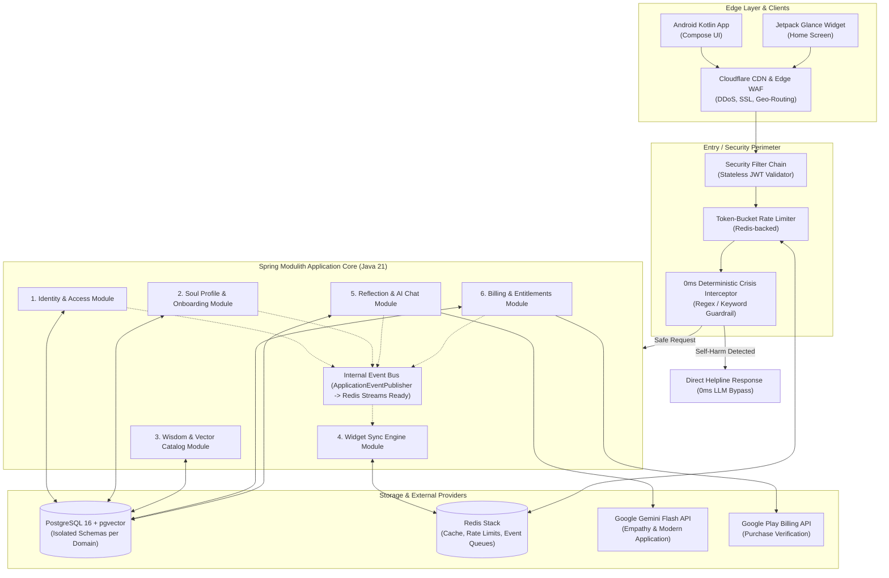
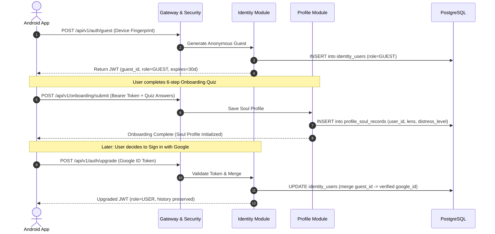
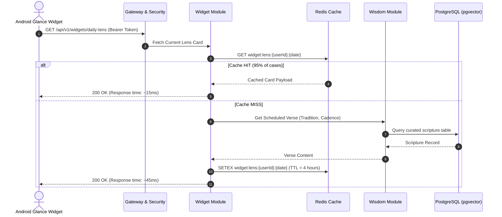
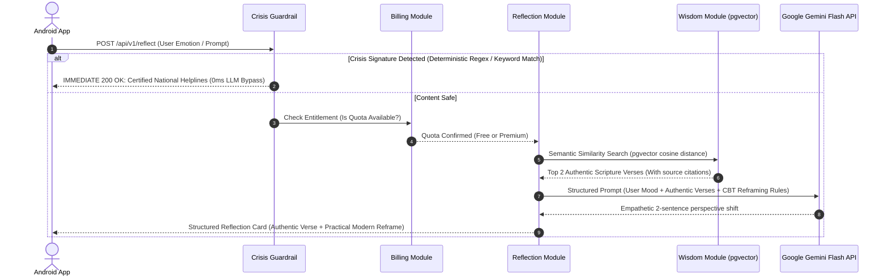
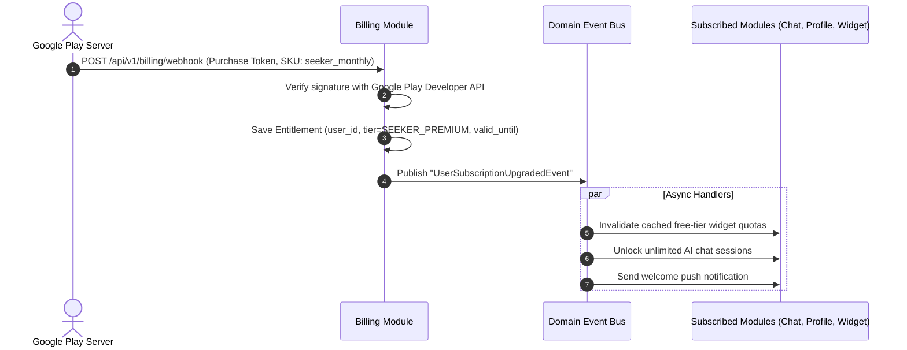
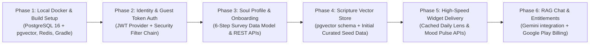

# Manasvia Backend: Enterprise Architecture & System Design Blueprint

> **"Ancient wisdom for your modern mind."**  
> An AI-powered spiritual and mental wellness companion backend engineered for high concurrency, zero-hallucination scripture retrieval, low-latency widget delivery, and effortless future microservice extraction.

---

## 1. Executive Summary & Architectural Paradigm

The Manasvia backend is architected as an **Event-Driven Modular Monolith (Spring Modulith / Hexagonal DDD)** running on **Java 21 LTS** and **Spring Boot 3.3.x**. 

### Why a Modular Monolith Today?
* **Single Deployment Unit**: Ultra-low operational overhead for early-to-mid stage growth. No Kubernetes clusters, service meshes, or network serialization latency between internal modules.
* **In-Memory Speed**: Inter-domain operations execute via high-speed Java method calls and in-memory application events.
* **Strict Boundary Enforcement**: Architecture tests fail the build if one module attempts to access internal entities or internal classes of another module.

### How It Guarantees Future Microservices Capability
Each module is designed as an isolated bounded context:
1. **Schema Isolation**: No cross-domain SQL joins in PostgreSQL.
2. **Interface Segregation**: Modules interact solely through clean public Java interfaces and read-only DTOs.
3. **Event-Driven Communication**: State changes emit Domain Events (`ApplicationEventPublisher` today $\to$ Kafka or Redis Streams tomorrow with zero business logic changes).

---

## 2. Production Technology Stack

| Layer | Chosen Technology | Architectural Purpose & Rationale |
| :--- | :--- | :--- |
| **Language & Runtime** | **Java 21 LTS (Project Loom)** | Enables Virtual Threads (`spring.threads.virtual.enabled: true`) for lightweight, high-concurrency non-blocking I/O. |
| **Core Framework** | **Spring Boot 3.3.x** | Enterprise dependency injection, security, connection pools, and actuator metrics. |
| **Architectural Guard** | **Spring Modulith** | Statically verifies module boundaries and auto-generates living architectural documentation. |
| **Security & Auth** | **Spring Security 6 + Stateless JWT** | Frictionless anonymous guest sessions, Google OAuth2, and stateless token verification across servers. |
| **Primary Database** | **PostgreSQL 16 + `pgvector`** | Combined relational ACID storage (users, logs, billing) and high-speed vector embeddings for semantic scripture search. |
| **Cache & Event Broker** | **Redis 7.2 (Redis Stack)** | Sub-millisecond widget response caching, token-bucket API rate limiting, and pub/sub message queues. |
| **AI / RAG Orchestrator** | **Spring AI + Google Gemini Flash API** | Grounded retrieval-augmented generation (RAG) at ultra-low latency and predictable cost. |
| **Database Migrations** | **Flyway** | Versioned, deterministic, and repeatable SQL schema migrations. |
| **Observability** | **Actuator + Micrometer + OpenTelemetry** | Real-time health metrics, Prometheus scraping, and distributed request tracing. |
| **Containerization** | **Docker & Multi-stage OCI builds** | Portable, cloud-agnostic deployment across AWS, GCP, or bare-metal VPS. |
| **Edge & CDN** | **Cloudflare CDN + WAF** | Global Anycast DNS, SSL termination, DDoS mitigation, and edge caching for static assets. |

---

## 3. High-Level Design (HLD)

### 3.1 System Context Diagram



---

## 4. Strict Rules for Future Microservice Extraction

To ensure zero friction when extracting any module into an independent service, the codebase adheres to three architectural laws:

### Law 1: Schema Isolation (No Cross-Domain SQL Joins)
* Tables are namespaced per module: `identity_*`, `profile_*`, `wisdom_*`, `widget_*`, `reflection_*`, `billing_*`.
* **Cross-module SQL `JOIN` queries are strictly prohibited.**
* If Module A needs data from Module B, it must call Module B's public interface or listen to replicated domain events.

### Law 2: Interface Segregation (No Entity Sharing)
* JPA Entities are strictly `package-private` inside each module.
* Other modules can only consume public immutable DTOs exposed via the module's `api/` package.

### Law 3: Asynchronous Event Decoupling
* Interactions that do not require an immediate return value are executed via **Domain Events**.
* Today: Handled in-memory via `ApplicationEventPublisher`.
* Tomorrow: Swapped for an external message broker (Kafka / Redis Streams) with zero modifications to business logic.

---

## 5. Bounded Contexts & Future Microservices Mapping

| Monolith Module | Core Domain Responsibilities | Future Microservice | Extraction Trigger |
| :--- | :--- | :--- | :--- |
| **`identity`** | Guest sessions, Google OAuth2, JWT lifecycle, account linking. | `Auth & Account Service` | Enterprise SSO, multi-tenant auth, or high account churn. |
| **`profile`** | Onboarding survey, soul profiles, distress baseline, user settings. | `User Profile Service` | Standard horizontal scaling with user growth. |
| **`wisdom`** | Curated scriptures (Gita, Bible, Quran, Stoics), vector embeddings, similarity search. | `Wisdom Catalog Service` | Heavy read traffic; benefits from edge caching and vector search replicas. |
| **`widget`** | High-speed daily card delivery, mood tap recorder, cache warming. | `Widget Engine Service` | Morning wake-up burst traffic (e.g., millions of devices querying at 7:00 AM). |
| **`reflection`** | RAG pipeline, CBT conversational reframing, prompt construction, LLM streaming. | `AI & RAG Service` | GPU acceleration, async worker queues, high latency LLM isolation. |
| **`billing`** | Google Play Billing verification, subscription lifecycle, entitlement flags. | `Billing & Entitlements Service` | Financial compliance, audit separation, webhook spikes. |

---

## 6. End-to-End System Flows

### Flow 1: Frictionless Guest Onboarding & Account Lifecycle



---

### Flow 2: High-Speed Widget Delivery (< 50ms)



---

### Flow 3: AI Reflection & Chat with Crisis Guardrail (RAG Pipeline)



---

### Flow 4: Subscription & Event-Driven Entitlement Flow



---

## 7. Package & Directory Architecture

```
Manasvia-Backend/
├── .dockerignore
├── Dockerfile                              # Multi-stage production container build
├── docker-compose.yml                      # Local PostgreSQL 16 (pgvector) + Redis 7.2
├── build.gradle.kts (or pom.xml)
├── settings.gradle.kts
├── README.md
│
└── src/
    ├── main/
    │   ├── java/com/manasvia/backend/
    │   │   │
    │   │   ├── Application.java            # Spring Boot entry point
    │   │   │
    │   │   ├── common/                     # Cross-Cutting Shared Kernel
    │   │   │   ├── config/                 # Redis, Async, Virtual Threads (Loom) configs
    │   │   │   ├── exception/              # Global error envelope, ErrorCodes, DomainExceptions
    │   │   │   ├── response/               # Standard ApiResponse<T> wrapper
    │   │   │   ├── security/               # JWT token parser, SecurityFilterChain, Principal context
    │   │   │   ├── guardrail/              # Deterministic Crisis regex patterns & dictionary
    │   │   │   └── events/                 # Base DomainEvent class & event publisher contract
    │   │   │
    │   │   └── modules/                    # ISOLATED BOUNDED CONTEXTS
    │   │       │
    │   │       ├── identity/               # [MODULE: Identity & Authentication]
    │   │       │   ├── api/                # Public contract (IdentityInternalApi, UserSummaryDto)
    │   │       │   ├── controller/         # /api/v1/auth (guest-login, google-auth, refresh-token)
    │   │       │   ├── dto/                # GuestLoginRequest, TokenResponse, GoogleAuthPayload
    │   │       │   ├── model/              # UserAccount, RefreshToken, UserRole (JPA Entities)
    │   │       │   ├── repository/         # UserRepository, RefreshTokenRepository
    │   │       │   └── service/            # AuthService, TokenProviderService
    │   │       │
    │   │       ├── profile/                # [MODULE: Soul Profile & Onboarding]
    │   │       │   ├── api/                # Public contract (ProfileInternalApi, SoulProfileDto)
    │   │       │   ├── controller/         # /api/v1/profile, /api/v1/onboarding
    │   │       │   ├── dto/                # OnboardingSubmissionDto, ProfileUpdateDto
    │   │       │   ├── model/              # SoulProfile, WisdomLensPreference, DistressSignature
    │   │       │   ├── repository/         # SoulProfileRepository
    │   │       │   └── service/            # ProfileService, OnboardingService
    │   │       │
    │   │       ├── wisdom/                 # [MODULE: Scripture Catalog & Vector Store]
    │   │       │   ├── api/                # Public contract (WisdomInternalApi, ScriptureVerseDto)
    │   │       │   ├── controller/         # /api/v1/wisdom (search, browse, traditions)
    │   │       │   ├── dto/                # VerseSearchQuery, VerseResponseDto
    │   │       │   ├── model/              # ScriptureVerse, Tradition, EmotionalTag
    │   │       │   ├── repository/         # VerseRepository (pgvector cosine similarity queries)
    │   │       │   └── service/            # WisdomSearchService, ScriptureEmbeddingService
    │   │       │
    │   │       ├── widget/                 # [MODULE: Widget Sync Engine]
    │   │       │   ├── controller/         # /api/v1/widgets (daily-lens, pulse-tap)
    │   │       │   ├── dto/                # DailyLensCardDto, MoodPulseTapDto
    │   │       │   ├── service/            # WidgetSyncService, WidgetCacheManager
    │   │       │   └── listener/           # Listens for profile/subscription updates to warm cache
    │   │       │
    │   │       ├── reflection/             # [MODULE: Reflection & AI Chat]
    │   │       │   ├── controller/         # /api/v1/reflect, /api/v1/chat
    │   │       │   ├── dto/                # ReflectionRequestDto, ReflectionResponseDto, ChatSessionDto
    │   │       │   ├── model/              # ReflectionLog, ChatSession, ChatMessage
    │   │       │   ├── repository/         # ReflectionLogRepository, ChatSessionRepository
    │   │       │   └── service/            # RagOrchestratorService, CbtPromptBuilder, GeminiClient
    │   │       │
    │   │       └── billing/                # [MODULE: Billing & Entitlements]
    │   │           ├── api/                # Public contract (BillingInternalApi, EntitlementStatusDto)
    │   │           ├── controller/         # /api/v1/billing (webhooks, verify-token)
    │   │           ├── dto/                # PurchaseVerificationRequest, SubscriptionStatusDto
    │   │           ├── model/              # UserEntitlement, SubscriptionHistory, Tier
    │   │           ├── repository/         # EntitlementRepository
    │   │           └── service/            # EntitlementService, PlayStoreBillingVerifier
    │   │
    │   └── resources/
    │       ├── application.yml             # Global shared properties
    │       ├── application-dev.yml         # Local Docker environment configuration
    │       ├── application-prod.yml        # Cloud Run / AWS ECS production profiles
    │       │
    │       └── db/migration/               # Flyway Deterministic Migrations
    │           ├── V1__init_identity_schema.sql
    │           ├── V2__init_profile_schema.sql
    │           ├── V3__init_pgvector_and_wisdom_schema.sql
    │           ├── V4__seed_verified_scriptures.sql
    │           ├── V5__init_reflection_and_chat_schema.sql
    │           └── V6__init_billing_and_entitlements_schema.sql
    │
    └── test/                               # Boundary verification & unit tests
        └── java/com/manasvia/backend/
            ├── ArchitectureTests.java      # Spring Modulith verification (fails build on boundary violations)
            └── modules/...                 # Domain module tests
```

---

## 8. Scalability & Operational Blueprint

### Handling 100,000+ Daily Active Users (DAU)
1. **Virtual Threads (Project Loom)**:
   * By setting `spring.threads.virtual.enabled: true`, incoming HTTP requests execute on lightweight virtual threads. 
   * Blocking I/O operations (database queries, Gemini API calls, Redis lookups) do not tie up OS threads, supporting tens of thousands of concurrent connections with minimal memory.
2. **Multi-Tier Caching**:
   * **Edge (Cloudflare)**: Static quotes and assets cached globally ($\approx 15\text{ms}$ response time).
   * **L2 Cache (Redis)**: Daily lens cards cached per user and date with a 4-hour TTL.
   * **Vector Search Index (pgvector)**: Scripture embeddings indexed via `HNSW` (Hierarchical Navigable Small World) for sub-10ms nearest-neighbor searches.
3. **Multi-Region Scalability**:
   * Application nodes in Asia and the Americas run the same stateless container image.
   * Read requests route to local regional read replicas; write operations route to the primary database.

---

## 9. Implementation Roadmap


