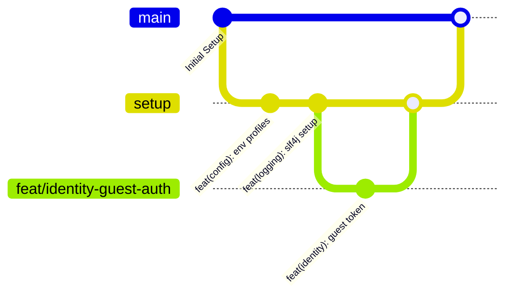
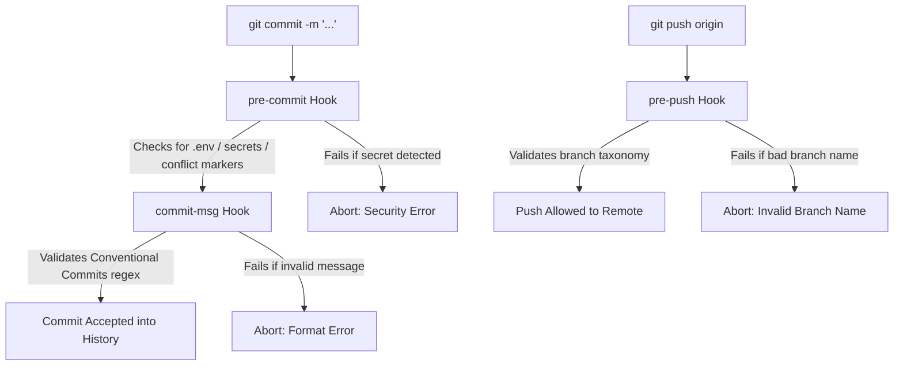

# Manasvia Git Workflow & Commit Guidance

> **Enterprise Version Control Standard**  
> Covers: Branching strategies, Conventional Commits specification, automated Git hooks (Husky equivalent), and IntelliJ IDEA integration.

---

## 1. Branching Strategy

Manasvia follows a **Feature Branch / Trunk-Based Development** model. Direct commits to `main` are restricted in production environments; all feature development and bug fixes must originate from dedicated branches.



### 1.1 Branch Taxonomy & Naming Rules

Branch names must use **lowercase letters**, **kebab-case**, and follow the pattern:
```text
<type>/<module>-<short-description>
```

| Type | Prefix | Description | Example |
| :--- | :--- | :--- | :--- |
| **Feature** | `feat/` | A new business feature, module API, or capability | `feat/identity-guest-login`<br>`feat/wisdom-vector-search` |
| **Bug Fix** | `fix/` | A bug fix or patch resolving an issue | `fix/jwt-expiration-timezone`<br>`fix/cors-preflight` |
| **Refactor** | `refactor/` | Code change that doesn't fix a bug or add a feature | `refactor/logging-mdc-filter`<br>`refactor/soul-profile-service` |
| **Performance** | `perf/` | Query optimization, caching, or latency improvements | `perf/widget-redis-cache`<br>`perf/pgvector-hnsw-index` |
| **Documentation**| `docs/` | Updates or additions to documentation or handbooks | `docs/api-specs-swagger`<br>`docs/git-workflow-guide` |
| **Build / Ops** | `build/` | Gradle build scripts, Docker configurations, toolchains | `build/gradle-virtual-threads`<br>`build/docker-compose-redis` |
| **Maintenance** | `chore/` | Housekeeping, dependency upgrades, cleanups | `chore/upgrade-spring-boot`<br>`chore/clean-deprecated-deps` |
| **Testing** | `test/` | Adding unit, integration, or architecture tests | `test/modulith-boundary-tests`<br>`test/identity-auth-mock` |
| **Baseline** | `setup`, `main` | Foundation bootstrap branch and production release branch | `setup`, `main` |

---

## 2. How to Create and Manage Branches

### Option A: Using the Command Line (CLI)

#### 1. Always start from the latest baseline branch
```powershell
# Navigate to the backend directory
cd C:\Users\v3p51\Projects\Manasvia\backend

# Ensure you have the latest updates
git checkout setup
git pull
```

#### 2. Create and switch to your new branch
```powershell
# Syntax: git checkout -b <type>/<module>-<description>
git checkout -b feat/identity-guest-session

# Or using modern git switch:
git switch -c feat/identity-guest-session
```

#### 3. Verify your current branch
```powershell
git branch
# * feat/identity-guest-session
#   main
#   setup
```

---

### Option B: Inside IntelliJ IDEA

1. Look at the **bottom-right corner** of IntelliJ (shows the current Git branch, e.g. `Git: setup`).
2. Click on the branch name.
3. Click **+ New Branch**.
4. Enter the branch name following the taxonomy (e.g. `feat/identity-guest-session`).
5. Ensure **Checkout branch** is checked, then click **Create**.

---

## 3. Commit Message Specification (Conventional Commits 1.0)

Every commit message in Manasvia is automatically validated by our `commit-msg` hook. Non-conforming commit messages are **strictly rejected**.

### 3.1 Format Anatomy

```text
<type>(<scope>): <short imperative description>

[optional body explaining 'why' and architectural choices]

[optional footer(s), e.g. BREAKING CHANGE or issue reference]
```

#### Key Rules:
1. **`<type>`** must be in lowercase (e.g. `feat`, `fix`, `refactor`).
2. **`(<scope>)`** is the Manasvia module or architectural layer being touched.
3. **Colon & Space (`: `)** must separate the type/scope from the description.
4. **`<short description>`**:
   * Use **imperative, present tense** ("add" not "added", "implement" not "implemented").
   * Start with a **lowercase** letter.
   * Do **NOT** place a period (`.`) at the end.
   * Maximum length: 80 characters.

---

### 3.2 Permitted Module Scopes for Manasvia

| Module Scope | Description / Area of Responsibility |
| :--- | :--- |
| `(identity)` | Authentication, Guest Sessions, JWT validation, User accounts |
| `(profile)` | Soul Profile, Seeker onboarding quiz, distress scoring |
| `(wisdom)` | Scripture catalog, verses, pgvector semantic search |
| `(widget)` | High-speed Android Glance widget payloads (<50ms delivery) |
| `(reflection)` | AI CBT reframing engine, Gemini RAG, crisis guardrails |
| `(billing)` | Google Play Store receipt verification, entitlement checks |
| `(security)` | Spring Security filters, CORS, rate-limiting |
| `(config)` | Multi-profile YAML (`dev`, `prod`, `test`), Docker Compose |
| `(logging)` | SLF4J, Logback, MDC correlation IDs, Morgan-style filter |
| `(gradle)` | Build scripts, dependencies, toolchains |

---

### 3.3 Commit Examples: Good vs. Bad

| Type | Status | Commit Message | Why |
| :--- | :---: | :--- | :--- |
| **Good** | :white_check_mark: | `feat(identity): implement anonymous guest token generation` | Clear type, valid scope, imperative description |
| **Good** | :white_check_mark: | `fix(security): resolve CORS preflight headers for Android client` | Specific, well-scoped bug fix |
| **Good** | :white_check_mark: | `refactor(logging): replace Lombok Slf4j with explicit LoggerFactory` | Explains what architectural change was made |
| **Good** | :white_check_mark: | `chore(gradle): add spring-modulith-starter-core dependency` | Clear maintenance commit |
| **Bad** | :x: | `Fixed bug in auth` | Missing type, missing scope, capitalized, past tense |
| **Bad** | :x: | `feat: added stuff` | Past tense, vague description, missing scope |
| **Bad** | :x: | `updates.` | Fails all Conventional Commits rules; trailing period |
| **Bad** | :x: | `feat(identity): Implemented Token.` | Capital letter, past tense, trailing period |

---

## 4. Automated Git Hooks (The Java/Gradle Husky Equivalent)

To maintain code hygiene without requiring Node.js or `npm`, the repository includes native version-controlled Git hooks in `backend/.githooks/`:

### 4.1 Installed Guards



1. **`commit-msg`**:
   * Inspects your commit message before saving.
   * If the format does not match `type(scope): message`, it stops the commit and prints an instructive error with examples.
2. **`pre-commit`**:
   * Protects against leaking secrets: blocks committing `.env`, `*.secret`, `*.keystore`, `*.jks`, or `google-services.json`.
   * Blocks commits containing unresolved merge conflict markers (`<<<<<<< HEAD`).
3. **`pre-push`**:
   * Enforces branch naming convention (`feat/*`, `fix/*`, `setup`, `main`, etc.) before pushing to GitHub.

### 4.2 Activating Hooks on a New Machine or Clone

Hooks are committed to version control in `backend/.githooks/`. To configure your local Git to use them, run:

```powershell
# From the backend directory:
.\gradlew.bat installHooks
```

This runs:
```powershell
git config core.hooksPath .githooks
git config commit.template .gitmessage
```

---

## 5. Daily Git Workflow Checklist

```powershell
# 1. Check current branch and modified files
git status

# 2. Stage your specific changes
git add src/main/java/com/manasvia/backend/modules/identity/

# 3. Commit with Conventional Commits message
git commit -m "feat(identity): implement guest JWT generation endpoint"

# 4. View your commit in the clean log
git log -n 5 --oneline
```
